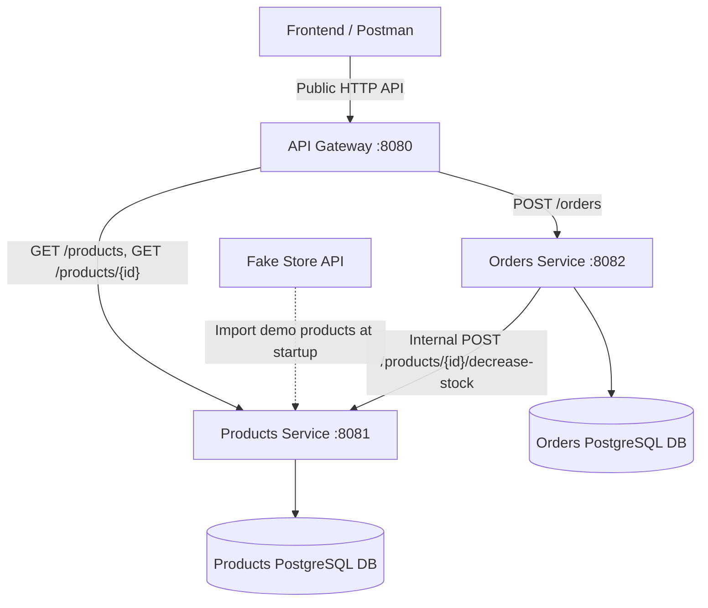
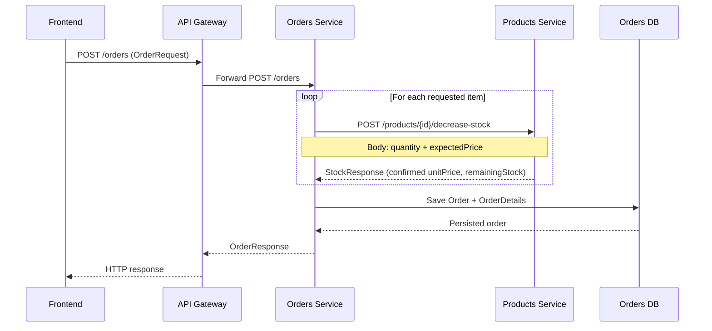

# Store API v0.3.0 — Java Spring Boot Microservices

A learning-focused backend for a small online store, evolving from a Spring Boot monolith into a microservices architecture.

**Version 0.3.0** introduces two independently running business services and a single API Gateway. It demonstrates HTTP communication between services, product and stock validation, order creation, and deliberate separation between public and internal endpoints.

> **Project status:** Educational prototype. The goal is to understand architectural decisions and their trade-offs before adding production-grade security, distributed consistency, and infrastructure automation.

## Architecture

The repository contains three independent Spring Boot applications:

| Application | Local port | Responsibility |
| --- | --- | --- |
| **API Gateway** | `8080` | Public HTTP entry point; matches paths and HTTP methods and forwards requests. |
| **Products Service** | `8081` | Product catalog, current prices, stock, and stock validation/decrement. |
| **Orders Service** | `8082` | Order creation, validation, inter-service orchestration, and order persistence. |



**Key distinction:** An *application/service* is the code and responsibility; an *instance* is one running copy of it. This version uses one local instance of each service. Multiple instances and load balancing are future topics.

## Technology stack

- Java 21
- Spring Boot 4.x
- Spring Cloud Gateway Server WebFlux
- Spring Web MVC (business services)
- Spring Data JPA and Hibernate
- PostgreSQL (separate persistence per business service)
- Spring `RestClient` for synchronous service-to-service HTTP
- Jackson for JSON serialization and deserialization
- Maven
- Fake Store API for demonstration product data

## Public API: what a frontend is allowed to call

The Gateway intentionally exposes only the operations needed for a basic shopping flow:

| Method | Gateway URL | Purpose | Destination |
| --- | --- | --- | --- |
| `GET` | `http://localhost:8080/products` | List products | Products Service |
| `GET` | `http://localhost:8080/products/{id}` | Read one product | Products Service |
| `POST` | `http://localhost:8080/orders` | Place an order | Orders Service |

The frontend is responsible for collecting selections and sending the agreed request JSON. **It must not decrement stock itself.** Orders Service coordinates the purchase and communicates with Products Service.

### Example: list the catalog

```http
GET http://localhost:8080/products
```

Example of the intended public product representation:

```json
[
  {
    "id": 1,
    "name": "Sample backpack",
    "price": 109.95,
    "stock": 10
  }
]
```

The frontend can refresh the catalog or request a single product again to display updated stock. This does **not** guarantee stock availability at checkout: Products Service must validate it again when an order is placed.

### Example: place an order

```http
POST http://localhost:8080/orders
Content-Type: application/json
```

```json
{
  "details": [
    {
      "productId": 1,
      "quantity": 2,
      "expectedPrice": 109.95
    },
    {
      "productId": 3,
      "quantity": 1,
      "expectedPrice": 55.50
    }
  ]
}
```

A successful order is created by Orders Service and returned using its `OrderResponse` DTO (including the generated order identifier and order information). The current controller is designed to respond with **`201 Created`** on successful creation.

The values above are illustrative. Product IDs, available stock, and prices depend on the current database contents.

## Internal API: not exposed through the Gateway

Products Service also implements operations such as:

| Method | Internal path | Purpose |
| --- | --- | --- |
| `POST` | `/products/{id}/decrease-stock` | Validate an item and decrement its stock. |
| `PUT` | `/products/{id}` | Update a product. |
| `DELETE` | `/products/{id}` | Delete a product. |

The stock endpoint is intended for **Orders Service → Products Service** communication, not direct frontend access.

### Stock-decrement contract

```http
POST http://localhost:8081/products/1/decrease-stock
Content-Type: application/json
```

```json
{
  "quantity": 2,
  "expectedPrice": 109.95
}
```

Successful response (`StockResponse`):

```json
{
  "productId": 1,
  "unitPrice": 109.95,
  "remainingStock": 8
}
```

Products Service checks that the product exists, `quantity` is positive, the expected price matches its current price, and sufficient stock remains. **Only after validation** does it decrement and persist the stock.

The product ID is in the **URL**, not the request body. This avoids duplicating the identifier in two locations and having to resolve contradictions.

## How an order is processed



1. The frontend submits an `OrderRequest` containing a list of `OrderDetailRequest` items (`productId`, `quantity`, `expectedPrice`).
2. `OrderService` validates the request and delegates HTTP communication to **`ProductsClient`**.
3. `ProductsClient` calls Products Service using Spring `RestClient`.
4. Products Service checks the product, price, quantity, and stock; if valid, it decrements stock and returns `StockResponse`.
5. `OrderService` builds an `OrderDetail` using **`stockResponse.unitPrice()`**, the price confirmed by Products Service, not the frontend's untrusted `expectedPrice`.
6. Orders Service persists the order and its details and responds to the client through the Gateway.

### Why `ProductsClient` is a separate class

`OrderService` owns business orchestration; `ProductsClient` owns the HTTP integration details. This keeps network calls out of the core order logic and makes the design easier to understand, test, and change.

Its conceptual method signature is:

```java
StockResponse decreaseStock(Long productId, StockRequest request);
```

The ID remains separate because the HTTP endpoint receives it as `@PathVariable`, whereas `StockRequest` is the JSON `@RequestBody` containing `quantity` and `expectedPrice`.

### Why the confirmed price matters

`expectedPrice` comes from the frontend and may already be outdated. Products Service compares it against the current price and returns the authoritative `unitPrice`. If the prices differ, order creation stops instead of silently charging a changed price.

## API Gateway configuration

The Gateway is its **own Spring Boot project**. For basic routing, it does not require a controller, JPA entities, repositories, or a database.

A representative `api-gateway/src/main/resources/application.properties` is:

```properties
spring.application.name=api-gateway
server.port=8080

# Public product reads
spring.cloud.gateway.server.webflux.routes[0].id=products-route
spring.cloud.gateway.server.webflux.routes[0].uri=http://localhost:8081
spring.cloud.gateway.server.webflux.routes[0].predicates[0]=Path=/products,/products/{id}
spring.cloud.gateway.server.webflux.routes[0].predicates[1]=Method=GET

# Public order creation
spring.cloud.gateway.server.webflux.routes[1].id=orders-route
spring.cloud.gateway.server.webflux.routes[1].uri=http://localhost:8082
spring.cloud.gateway.server.webflux.routes[1].predicates[0]=Path=/orders
spring.cloud.gateway.server.webflux.routes[1].predicates[1]=Method=POST
```

### Reading the route properties

- **`routes[0]` / `routes[1]`**: first and second route configuration objects. Each route has its own list of predicates, indexed independently from `[0]`.
- **`id`**: a logical identifier for the route. Renaming it does not change where traffic goes.
- **`uri`**: the destination service address; in this example, localhost and a fixed port.
- **`predicates`**: conditions for route selection. `Path` checks the request path, while `Method` checks the HTTP method. All predicates on a route must match.
- **`filters`**: optional operations on matched requests/responses (for example, adding a response header or changing a forwarded path). This version does not need a custom filter.

`Path` is part of an HTTP URI; a **Path predicate** is a *condition that examines* that path. `**` is a Spring path-pattern wildcard; it is not Java syntax. The intentionally narrow patterns above avoid routing every operation under `/products/**` to the public API.

### Why expose only three operations?

Keeping internal actions off the public Gateway route table reduces the exposed API surface and separates the public contract from service-to-service operations. **This is not a complete security boundary.** In local development, internal ports may still be reachable directly. A real deployment also needs network isolation and appropriate authentication/authorization, including protection of sensitive service-to-service operations.

### Configuration binding and startup arguments

Spring Boot loads settings from `application.properties` and other sources, then **binds** relevant values to Java configuration objects. List indexes in the properties file configure different list entries and fields; they do not overwrite each other when the property names differ.

For example, the same JAR can run with an overridden port:

```bash
java -jar api-gateway.jar --server.port=9090
```

The arguments reach `main(String[] args)` and are passed to `SpringApplication.run(ApiGatewayApplication.class, args)`. The `Class` object identifies the main configuration class; `args` carries launch-time properties. Command-line properties normally override the same keys in `application.properties` without editing that file.

## HTTP responses and error handling

### Who owns an error?

- **Products Service** validates products, prices, and stock and creates responses for its own business errors.
- **Orders Service** decides the final response to the customer when an internal call to Products Service fails.
- **API Gateway** normally forwards the selected service's HTTP status and response body; it may process certain headers and any configured filters.

Examples of application-level outcomes:

| Situation | Typical HTTP response |
| --- | --- |
| Product read succeeds | `200 OK` + product JSON |
| Order creation succeeds | `201 Created` + `OrderResponse` |
| Invalid quantity | `400 Bad Request` |
| Product not found | `404 Not Found` |
| Price or stock conflict, when handled as a conflict | `409 Conflict` + error JSON |
| Unhandled server/infrastructure exception | `500 Internal Server Error` |

**The concrete response always depends on the corresponding controller and exception-handler implementation.**

### Error propagation: Products → Orders → Gateway

Suppose Products Service responds:

```http
HTTP/1.1 409 Conflict
Content-Type: application/json
```

```json
{
  "message": "Insufficient stock"
}
```

With `RestClient.retrieve()`, an HTTP 4xx/5xx response normally raises an exception rather than returning `StockResponse`. Orders Service can catch/handle an `HttpClientErrorException.Conflict`, read its response body (for example, through `getResponseBodyAs(Map.class)`), and **explicitly build its own `409` response** using the received message. The Gateway then forwards Orders Service's response to the frontend.

This is **not** a byte-for-byte automatic pass-through between business services: Orders Service owns the public error contract and may preserve or translate the upstream response.

### Service or database unavailable

- If Products Service is offline, a call from Orders Service can fail with a `ResourceAccessException`. Without a specific handler, Orders Service typically returns a generic `500`.
- If PostgreSQL is unavailable during a JPA call, `findById()` throws an exception rather than returning `Optional.empty()`. An unhandled failure typically results in `500`.
- A `404` can come from the Gateway when no route matches **or** from the destination service when a matching route was forwarded but the requested endpoint/resource was not found.
- An HTTP connection error at the Gateway is different from an application-level error returned by a running service; its resulting status depends on the Gateway configuration and failure type.

More deliberate mapping to `503 Service Unavailable`, timeouts, retries, and circuit breakers are **future improvements**, not features claimed for this version.

## Persistence and data ownership

Products Service and Orders Service have independent persistence responsibilities. Orders stores its own `Order` and `OrderDetail` records. An order detail keeps the **product ID as a value**, not as a JPA `@ManyToOne` relationship to an entity owned by Products Service.

This differs from the original monolith, where `detalle_pedido.producto_id` could be a real foreign key to a product in the same database. Across separately owned microservice databases, **there is no cross-service database foreign key**; consistency is coordinated through the service API.

The demo imports **20 sample products from Fake Store API** and assigns **10 units of initial stock** to each imported product. Spring Boot can perform this import after startup via `@EventListener(ApplicationReadyEvent.class)`. Only selected external fields are needed; Jackson can ignore additional JSON properties not declared in the import DTO.

> **Development warning:** If a service uses `spring.jpa.hibernate.ddl-auto=create`, Hibernate recreates its mapped tables on startup. This deletes previously stored data in those tables. Do not use that setting for persistent production data.

## Running locally

### Requirements

- JDK 21
- Maven (or the Maven Wrapper included with each Spring Boot project)
- PostgreSQL running locally
- Three available ports: `8080`, `8081`, and `8082`

### Setup

1. Create/configure a separate PostgreSQL database for Products Service and Orders Service.
2. Configure the database URL, username, and password for each service locally. **Do not commit real database passwords or other secrets.**
3. Ensure Products Service uses `8081`, Orders Service uses `8082`, and the Gateway uses `8080`.
4. Start each application in a separate terminal or IntelliJ run configuration.

For example, from each project directory:

```bash
mvn spring-boot:run
```

Start **Products Service**, then **Orders Service**, then **API Gateway**. Each is an independent process and can be started from its own IDE run configuration as well.

### Quick smoke tests

```bash
# Through the Gateway: list the catalog
curl http://localhost:8080/products

# Through the Gateway: fetch one product
curl http://localhost:8080/products/1

# Through the Gateway: create an order
curl -X POST http://localhost:8080/orders \
  -H 'Content-Type: application/json' \
  -d '{"details":[{"productId":1,"quantity":2,"expectedPrice":109.95}]}'
```

Use the **current** price from `GET /products/1` in the order request. These commands assume the services, databases, and demo product import have started successfully.

Also test that requests such as `PUT /products/1` and `POST /products/1/decrease-stock` do **not** match a public Gateway route. This check does not prove the internal services are protected from direct network access.

## Known limitations and next steps

This release deliberately keeps the design simple so that failures and architectural trade-offs are visible:

- **Distributed transactions are not atomic.** If an order contains multiple items and earlier stock decrements succeed before a later call fails, the previous decrements are not automatically rolled back across services.
- **Concurrent purchases can race.** This first version does not yet implement a full strategy for stock reservation, locking, or atomic conditional updates.
- **No automatic load balancing or service discovery.** Gateway destinations are configured as fixed local URLs.
- **No production-ready security.** Gateway route restrictions do not replace authentication, authorization, or private networking.
- **No complete resilience policy.** Explicit retry/backoff, timeouts, circuit breakers, observability, and standardized infrastructure error responses remain future work.
- **Demo persistence behavior may reset data** when Hibernate schema generation is configured with `create`.

Potential future iterations will address concurrent inventory updates, distributed consistency/compensation, security, service discovery, Docker Compose, automated testing, and a fuller public API.

## Evolution of the project

| Version | Focus |
| --- | --- |
| [v0.1.0](https://github.com/GiulianoUgolino/springboot-store-api) | Spring Boot monolith with products, orders, JPA, and PostgreSQL. |
| [v0.2.0](https://github.com/GiulianoUgolino/springboot-store-api-v2) | External product import using Fake Store API, `RestClient`, and startup initialization. |
| **v0.3.0 (this repository)** | Products and Orders microservices, inter-service HTTP, stock validation, and API Gateway. |

## References

- [Spring Cloud Gateway documentation](https://docs.spring.io/spring-cloud-gateway/reference/)
- [Spring Framework — REST clients](https://docs.spring.io/spring-framework/reference/integration/rest-clients.html)
- [Spring Boot externalized configuration](https://docs.spring.io/spring-boot/reference/features/external-config.html)
- [Fake Store API](https://fakestoreapi.com/)

---

**Author:** [Giuliano Ugolino](https://github.com/GiulianoUgolino)  
**Purpose:** Learning backend development with Java and Spring Boot through progressive, explainable architectural versions.
